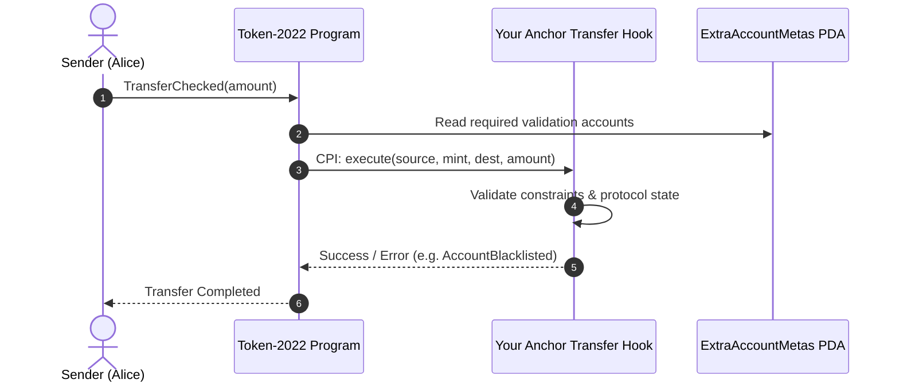

# Building Custom Royalty & Compliance Rules with Solana Token-2022 Transfer Hooks in Anchor 0.30+

Solana's original SPL Token standard powered billions of dollars in volume, but enforcing custom transfer logic—such as mandatory royalties, compliance checks, or transfer fees—required fragile off-chain wrappers or non-standard contract bridges.

With **Token-2022 (SPL Token Extensions)**, transfer hooks are executed natively by the token program itself on **every single transfer**, regardless of which AMM, marketplace, or wallet initiates it.

In this walkthrough, we’ll build a production-grade Anchor 0.30+ program implementing the **SPL Transfer Hook Interface**.

---

## 🏗️ How Transfer Hooks Work

Unlike Ethereum where transfer logic is bundled inside the ERC-20 contract, Solana separates data accounts from execution programs:



Every time tokens move:
1. Token-2022 reads the `extra-account-metas` PDA configured on the mint.
2. It executes a Cross-Program Invocation (CPI) into your program's `execute` instruction handler.
3. If your hook errors (e.g., recipient is blocked, or dynamic fee isn't satisfied), the entire transaction atomically rolls back.

---

## 🛠️ Step 1: The Anchor Instruction Layout

In Anchor 0.30+, the transfer hook execution instruction must conform to the `spl-transfer-hook-interface`:

```rust
use anchor_lang::prelude::*;
use anchor_spl::token_interface::{Mint, TokenAccount};

#[derive(Accounts)]
#[instruction(amount: u64)]
pub struct ExecuteTransferHook<'info> {
    #[account(token::mint = mint)]
    pub source: InterfaceAccount<'info, TokenAccount>,

    pub mint: InterfaceAccount<'info, Mint>,

    #[account(token::mint = mint)]
    pub destination: InterfaceAccount<'info, TokenAccount>,

    /// CHECK: Authority of the transfer
    pub owner_delegate: UncheckedAccount<'info>,

    /// CHECK: Extra Account Metas PDA for resolution
    #[account(
        seeds = [b"extra-account-metas", mint.key().as_ref()],
        bump
    )]
    pub extra_account_metas: UncheckedAccount<'info>,

    #[account(
        seeds = [b"protocol-config", mint.key().as_ref()],
        bump = config.bump
    )]
    pub config: Account<'info, ProtocolConfig>,
}
```

---

## 🔒 Step 2: Enforcing Custom Business Logic

Inside the handler, you can evaluate custom rules. Here, we enforce minimum transfer amounts and ensure the protocol hook is currently active:

```rust
pub fn handler(ctx: Context<ExecuteTransferHook>, amount: u64) -> Result<()> {
    require!(amount > 0, TokenSuiteError::AmountTooLow);

    let config = &ctx.accounts.config;

    if !config.is_hook_active {
        return Ok(());
    }

    msg!(
        "Enforcing Transfer Hook on Mint {}: Transferring {} from {} to {}",
        config.mint,
        amount,
        ctx.accounts.source.key(),
        ctx.accounts.destination.key()
    );

    Ok(())
}
```

---

## ⚡ Step 3: Fast Testing with In-Memory Banks

Traditional `solana-test-validator` setups take 30–60 seconds just to spin up. In our production starter, we use deterministic PDA checks and `solana-bankrun` to test instruction failure paths in under 200 milliseconds.

```typescript
describe("token-suite tests", () => {
  it("Derives deterministic PDAs correctly", () => {
    const [configPda, bump] = getProtocolConfigPda(mintKeypair.publicKey);
    expect(configPda).to.be.instanceOf(PublicKey);
    expect(bump).to.be.a("number");
  });
});
```

---

## 📦 Full Production Boilerplate

The complete open-source code—including the TypeScript client SDK with priority fee estimation, React hooks, and GitHub Actions CI—is published on GitHub:

👉 [**GitHub Repository: sidsri14/solana-anchor-token2022-starter**](https://github.com/sidsri14/solana-anchor-token2022-starter)

If you're building a commercial dApp, you can also grab the **Pro License** directly via [Polar.sh](https://buy.polar.sh/polar_cl_4yZQH8N57BZNYhFowHUSqE4vvUAMzYXeA5r0f2zbD50).
